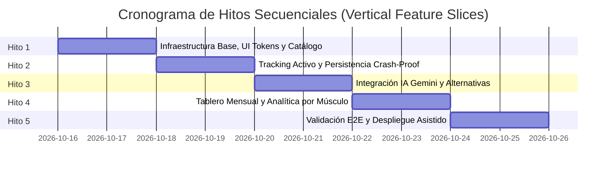

# PLAN: Hoja de Ruta y Plan de Desarrollo (Roadmap)
**Proyecto:** AppFit - Asistente de Entrenamiento Inteligente Mobile-First  
**Versión:** 1.0.0 (MVP)  
**Estado:** Aprobado  
**Fecha:** 2026-10-15  

---

## 1. Definición del Alcance: MVP vs. Iteraciones Futuras

### 1.1 Núcleo Mínimo Viable (Fase 1 - MVP)
- Desbloqueo rápido mediante PIN táctil de 4 dígitos.
- Detección del día y prescripción sugerida de grupo muscular (split diario editable).
- Catálogo interactivo de ejercicios con imágenes descriptivas optimizadas.
- Registro en vivo de series, repeticiones y peso con persistencia local anti-cierre.
- Motor de ejercicios alternativos asistido por IA (Gemini API) con contingencia offline.
- Tablero de métricas mensuales: total de días entrenados y desglose por grupo muscular.
- Interfaz en Modo Oscuro de alto contraste con botones táctiles de gran tamaño.

### 1.2 Iteración Táctica (Fase 2)
- Temporizador flotante de descanso entre series (ej. 60s / 90s) con alerta táctil/vibración.
- Indicador de sobrecarga progresiva en tarjeta de ejercicio (marca histórica de la sesión previa).
- Capacidades de Progressive Web App (PWA) instalable en la pantalla de inicio del smartphone.

### 1.3 Analítica Avanzada (Fase 3)
- Gráficas evolutivas de volumen de carga (tonelaje levantado) a lo largo del tiempo.
- Exportación e importación de copias de seguridad de datos en formato JSON/CSV.

---

## 2. Estructura de Hitos Secuenciales (Enfoque por Características Verticales)

### Hito 1: Cimientos del Proyecto, UI Tokens y Catálogo Visual
- **Objetivo:** Inicializar la estructura de código, definir el sistema de diseño oscuro mobile-first y disponer del catálogo base de ejercicios con imágenes.
- **Entregables:**
  - Repositorio estructurado con frontend React (Vite) y backend Node.js (Express).
  - Hoja de estilos con variables CSS nativas (colores Dark Mode, espaciados táctiles de 48px mínimo).
  - Pantalla de ingreso con teclado numérico para PIN de 4 dígitos.
  - Catálogo inicial de grupos musculares y ejercicios con imágenes de ejemplo.

### Hito 2: Motor de Rutina Diaria y Registro de Series (Live Tracking)
- **Objetivo:** Permitir al usuario seleccionar el músculo del día y registrar sus series en tiempo real sin riesgo de pérdida de datos.
- **Entregables:**
  - Selector de grupo muscular con sugerencia predeterminada por día de la semana.
  - Tarjetas interactivas de ejercicios con contadores rápidos de peso y repeticiones.
  - Persistencia automática en caliente (LocalStorage / SQLite mediante Prisma).
  - Capacidad de editar y revertir series marcadas.

### Hito 3: Asistente IA (Gemini BFF) para Alternativas de Ejercicios
- **Objetivo:** Resolver el problema de máquinas ocupadas mediante sugerencias dinámicas inteligentes.
- **Entregables:**
  - Endpoint seguro backend `POST /api/ai/alternative-exercise` con variable protegida `.env`.
  - Prompts estructurados para Gemini con validación estricta Zod.
  - Botón táctil "Pedir alternativa" en la tarjeta del ejercicio con indicador de carga.
  - Mecanismo de fallback local con ejercicios de respaldo en caso de latencia o desconexión.

### Hito 4: Tablero Mensual y Cierre de Sesión
- **Objetivo:** Proporcionar la retroalimentación de cumplimiento de hábitos y balance muscular.
- **Entregables:**
  - Botón "Terminar Entrenamiento" con guardado definitivo de la sesión.
  - Pantalla modal de felicitación y resumen de la jornada.
  - Vista mensual interactiva: total de días entrenados en el mes actual y gráfico de pastel/barras de grupos musculares trabajados.

### Hito 5: Batería de Pruebas E2E y Despliegue Guiado en Producción
- **Objetivo:** Garantizar la estabilidad de la app y dejarla funcionando en el celular del usuario vía enlace público HTTPS.
- **Entregables:**
  - Suite de pruebas Playwright emulando navegación en smartphone.
  - Configuración del despliegue en Render / Railway con persistencia de base de datos.
  - Guía paso a paso ilustrada para vincular el repositorio y acceder desde el smartphone mediante código QR.
  - Configuración del sistema de registro de errores (`error.log`) y health check (`/health`).

---

## 3. Puertas de Calidad y Criterios de Parada (Validation Gates)

Para asegurar un desarrollo sin regresiones, cada hito debe cumplir las siguientes compuertas antes de ser promovido al siguiente:

| Compuerta | Mecanismo de Control | Criterio de Aceptación Obligatorio |
| :--- | :--- | :--- |
| **G1: Compilación Limpia** | `npm run build` | Cero errores de sintaxis y cero advertencias críticas de TypeScript |
| **G2: Contratos de Datos** | Validación Zod | Todas las entradas y respuestas de IA cumplen con los esquemas tipados |
| **G3: Pruebas Automáticas** | `npx playwright test` | 100% de los tests E2E móviles aprobados |
| **G4: Validación Humana** | Demostración Táctil | Aprobación explícita del usuario ("Go") tras probar la interfaz móvil |

---

## 4. Tamaño y Granularidad de las Tareas (Backlog Modular)

El desarrollo se ejecutará mediante **Tareas Modulares Medianas** para optimizar la atención de la IA y facilitar la auditoría:
- Cada tarea agrupa un componente de interfaz, su lógica asociada, su endpoint y su prueba correspondiente.
- Límite de modificación por tarea: no más de 3 a 5 archivos vinculados directamente.

---

## 5. Estrategia de Despliegue Asistido (Paso a Paso)

1. **Paso A: Creación del Repositorio:** Subida del código a GitHub con archivo `.gitignore` protegiendo variables `.env` y bases de datos locales.
2. **Paso B: Conexión con Render / Railway:** Asistencia paso a paso para crear el Web Service gratuito/económico.
3. **Paso C: Inyección de Secretos:** Configuración guiada de las variables `APP_PIN` y `GEMINI_API_KEY` en el panel de control.
4. **Paso D: Prueba de Fuego Móvil:** Acceso desde el celular mediante escaneo de código QR y validación del flujo completo en el gimnasio.
