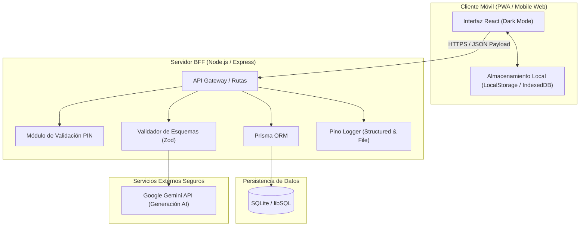
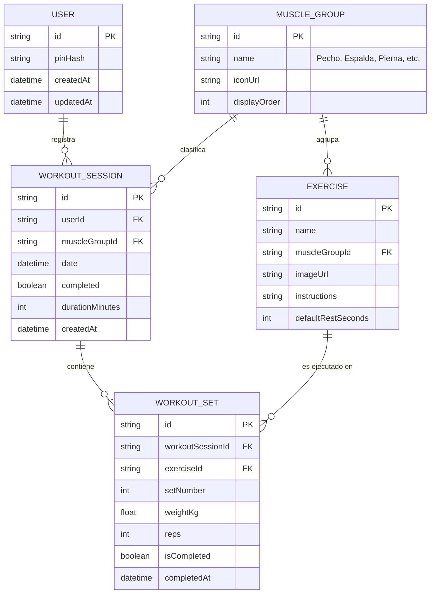

# TRD: Documento de Requisitos Técnicos (Technical Requirements Document)
**Proyecto:** AppFit - Asistente de Entrenamiento Inteligente Mobile-First  
**Versión:** 1.0.0 (MVP)  
**Estado:** Aprobado  
**Fecha:** 2026-10-15  

---

## 1. Stack Tecnológico y Arquitectura de Software

### 1.1 Stack Seleccionado
- **Frontend:**
  - **Framework / Bundler:** React 18+ con Vite (compilación ultrarrápida y mínimo bundle size).
  - **Lenguaje:** TypeScript (seguridad de tipos en componentes y contratos de datos).
  - **Estilos:** Vanilla CSS / Modern CSS Tokens (variables nativas HSL, Dark Mode, layout flexbox/grid optimizado para pantallas táctiles sin Tailwind ni sobrecoste de runtime).
  - **Iconos y Recursos:** Iconos SVG limpios y catálogo local de imágenes de ejercicios optimizadas en WebP.
- **Backend / BFF (Backend-for-Frontend):**
  - **Runtime & Servidor:** Node.js con Express o Fastify.
  - **Capa BFF:** Actúa como proxy seguro y controlador de lógica de negocio, intermediando entre el cliente web y los servicios de base de datos e IA.
- **Inteligencia Artificial:**
  - **Proveedor:** Google Gemini API (modelo `gemini-1.5-flash` / `gemini-2.0-flash` o equivalente ultraligero).
  - **Modo:** Generación estructurada JSON forzada para garantizar respuestas parseables de ejercicios alternativos.

### 1.2 Diagrama de Arquitectura de Alto Nivel



---

## 2. Modelo de Datos y Persistencia (ERD)

### 2.1 Motor de Base de Datos
- **Motor:** **SQLite** (archivo local de alto rendimiento, ideal para despliegues ligeros y mantenibles sin costos de infraestructura).
- **ORM & Migraciones:** **Prisma ORM** con `prisma migrate dev` y `prisma migrate deploy` para control de cambios esquemáticos versionados.

### 2.2 Diagrama Entidad-Relación (ERD)



### 2.3 Diccionario de Datos

| Entidad | Campo | Tipo | Restricción | Descripción |
| :--- | :--- | :--- | :--- | :--- |
| **User** | `id` | UUID / CUID | Primary Key | Identificador del usuario propietario |
| **User** | `pinHash` | String | Not Null | Hash criptográfico del PIN de 4 dígitos |
| **MuscleGroup** | `name` | String | Unique | Nombre del grupo (ej. Pecho, Espalda, Pierna) |
| **Exercise** | `muscleGroupId`| String | Foreign Key | Relación con el grupo muscular |
| **WorkoutSession**| `date` | Date / String | Not Null | Fecha YYYY-MM-DD para cómputo de métricas |
| **WorkoutSet** | `weightKg` | Float | Check (>= 0) | Carga levantada en kilogramos |
| **WorkoutSet** | `reps` | Integer | Check (> 0) | Repeticiones completadas |

---

## 3. Integración de APIs y Arquitectura de Seguridad

### 3.1 Patrón BFF y Seguridad de Secretos
- **Regla del "Cliente Limpio":** Ningún token ni clave secreta se expone en el código cliente.
- Las peticiones hacia la IA son intermediadas por el endpoint backend `POST /api/ai/alternative-exercise`.
- La variable `GEMINI_API_KEY` reside exclusivamente en el archivo `.env` del servidor.

### 3.2 Autenticación con PIN de 4 Dígitos
- El cliente envía el PIN ingresado al endpoint `POST /api/auth/verify-pin`.
- El servidor valida el PIN mediante hash seguro (ej. Argon2 o Bcrypt) y emite un token de sesión ligero (JWT en cookie HttpOnly o Bearer Header) para autorizar las solicitudes subsecuentes.

### 3.3 Endpoint de la IA y Esquema de Respuesta
```typescript
// Contrato de respuesta Zod esperado desde Gemini API
export const AlternativeExerciseSchema = z.object({
  exerciseName: z.string().min(2),
  targetMuscle: z.string(),
  reasonForAlternative: z.string(),
  recommendedSets: z.number().int().positive(),
  recommendedReps: z.string(), // ej. "10-12"
  equipmentNeeded: z.string(),
  executionTip: z.string()
});
```

---

## 4. Estrategia de Pruebas y Robustez (Harness & Testing)

### 4.1 Pruebas End-to-End (E2E) con Playwright
- **Configuración de Emulación:** Dispositivo móvil emulado (`Pixel 7` / `iPhone 14`).
- **Casos de Prueba Críticos E2E:**
  1. `auth.spec.ts`: Desbloqueo mediante teclado táctil con PIN correcto e incorrecto.
  2. `workout-tracking.spec.ts`: Carga de rutina del día, incremento de pesos/reps con botones táctiles y guardado de series.
  3. `ai-alternative.spec.ts`: Solicitud de ejercicio alternativo con mock de IA y fallback de desconexión.
  4. `monthly-metrics.spec.ts`: Finalización de sesión y verificación del incremento en el contador mensual de días entrenados.

### 4.2 Esquemas de Validación y Tipado Estricto
- Validación de todas las peticiones entrantes en el backend mediante **Zod**.
- Verificación de tipos estática en el pipeline con `tsc --noEmit`.

---

## 5. Operaciones, Despliegue y Observabilidad

### 5.1 Entorno de Alojamiento y Despliegue Guiado
- **Plataforma Objetivo:** **Render** o **Railway**.
- **Estructura del Despliegue:**
  - Build estática de Vite servida como archivos estáticos por el servidor Express o servicio web unificado.
  - Base de datos SQLite contenida en disco persistente (Persistent Disk).
  - Variables de entorno mínimas configurables desde el dashboard web:
    - `PORT=3000`
    - `NODE_ENV=production`
    - `APP_PIN=1234`
    - `GEMINI_API_KEY=AIzaSy...`

### 5.2 Observabilidad y Telemetría
- **Logs Estructurados:** Implementación con **Pino Logger** con niveles diferenciados (`info`, `warn`, `error`).
- **Registro Persistente de Errores:** Rotación de archivo `logs/error.log` para registrar excepciones sin comprometer el almacenamiento.
- **Health Check Endpoint:** Ruta `/health` que verifica la conectividad con la base de datos y el estado general de la aplicación.
