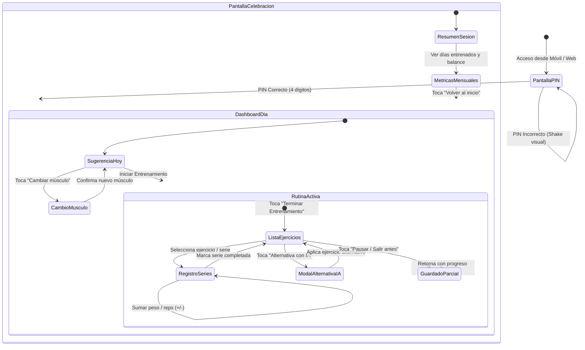
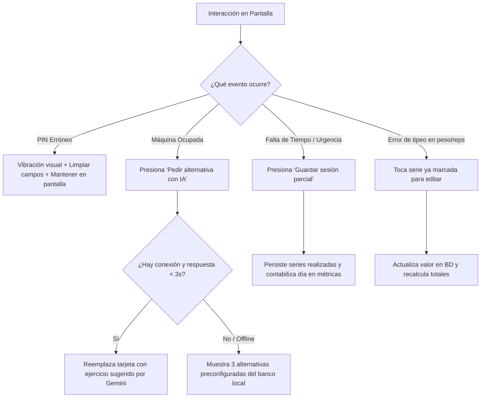

# USER FLOW: Flujo de Navegación y Experiencia de Usuario
**Proyecto:** AppFit - Asistente de Entrenamiento Inteligente Mobile-First  
**Versión:** 1.0.0 (MVP)  
**Estado:** Aprobado  
**Fecha:** 2026-10-15  

---

## 1. Diagrama Global de Navegación

---

## 2. El "Happy Path" o Camino Crítico Paso a Paso

El siguiente es el recorrido ideal y sin fricciones del usuario al acudir al gimnasio:

### Paso 1: Acceso Táctil con PIN (Entry Point)
- **Pantalla:** Pantalla de bloqueo minimalista en Modo Oscuro.
- **Acción:** El usuario pulsa los 4 dígitos en el teclado numérico en pantalla.
- **Transición:** Al pulsar el cuarto dígito correcto, se valida la sesión y se ingresa automáticamente al Dashboard sin requerir botón adicional de "Entrar".

### Paso 2: Prescripción Diaria y Selección de Músculo
- **Pantalla:** Dashboard Principal del Día.
- **Contenido:**
  - Encabezado con saludo y fecha actual: *"Hoy es Jueves, 15 de Octubre"*.
  - Tarjeta destacada de sugerencia: *"Entrenamiento Sugerido: **Espalda y Bíceps**"*.
  - Botón secundario *"Cambiar grupo muscular"* por si el usuario prefiere entrenar otro grupo hoy.
- **Acción:** El usuario presiona el botón principal *"Empezar Rutina de Hoy"*.

### Paso 3: Ejecución de la Rutina y Registro de Series
- **Pantalla:** Pantalla de Entrenamiento Activo.
- **Contenido:**
  - Lista de 4 a 6 tarjetas de ejercicios con sus imágenes ilustrativas.
  - Para cada ejercicio: 3 a 4 filas de series con inputs táctiles para **Peso (Kg)** y **Repeticiones (Reps)**.
  - Cada fila cuenta con botones táctiles grandes de incremento y decremento (`+` y `-`).
- **Acción:**
  - El usuario realiza la serie en el gimnasio.
  - Ajusta el peso y repeticiones ejecutadas.
  - Presiona el botón de confirmación táctil `✓`. La fila se colorea con acento esmeralda indicando serie completada.
  - Los datos se respaldan inmediatamente en el almacenamiento local (*Crash-proof*).

### Paso 4: Cierre del Entrenamiento
- **Pantalla:** Pie de la pantalla de rutina activa.
- **Acción:** Al finalizar la última serie, el usuario presiona el botón destacado *"Terminar Entrenamiento"*.

### Paso 5: Pantalla de Celebración y Métricas del Mes
- **Pantalla:** Resumen de Rendimiento y Hábito.
- **Contenido:**
  - Animación sutil de felicitación.
  - Resumen de la sesión: *"¡Excelente sesión! 5 ejercicios completados | 18 series realizadas | 6.420 kg levantados en total"*.
  - **Métrica Clave de Hábito:** *"Llevas **14 días entrenados** este mes"*.
  - Gráfico visual de balance de grupos musculares trabajados en el mes en curso.
- **Acción:** Botón *"Listo por hoy"*, que regresa al Dashboard en estado de descanso con un contador para la sesión de mañana.

---

## 3. Bifurcaciones Lógicas y Escenarios Alternativos (Edge Cases)

### Detalle de Escenarios Alternativos:
1. **PIN Incorrecto:** Los 4 indicadores circulares parpadean en rojo con vibración sutil. Se borra la entrada para permitir reescribir inmediatamente sin bloquear la cuenta.
2. **Máquina u Equipo Ocupado:** Al pulsar *"Alternativa IA"*, se envía el identificador del ejercicio y grupo muscular al backend. Si la API de Gemini responde, el ejercicio se actualiza dinámicamente conservando el número de series pendientes. Si la llamada excede 3 segundos o el dispositivo está sin cobertura en el sótano del gym, se presenta una lista desplegable con ejercicios libres alternativos (mancuernas/peso corporal).
3. **Entrenamiento Interrumpido:** Un botón discreto en la parte superior permite presionar *"Guardar y Salir"*. La sesión se cierra registrando las series ejecutadas hasta ese momento, contabilizando el día en las métricas mensuales.
4. **Corrección de Valores:** Tocar cualquier serie ya completada abre un mini editor rápido para corregir un número mal ingresado sin reiniciar la sesión.

---

## 4. Estados de la Interfaz (UI States)

### 4.1 Estados de Carga (Loading States)
- **Carga de Rutina:** Tarjetas con efecto *Skeleton* (bloques rectangulares en gris oscuro con destello gradual animado) que respetan la forma exacta de los ejercicios para evitar saltos de diseño (*layout shifts*).
- **Consulta de IA:** La tarjeta del ejercicio muestra una insignia pulsante *"Buscando la mejor alternativa..."* deshabilitando temporalmente el botón para prevenir doble pulsación.

### 4.2 Estados Vacíos (Empty States)
- **Inicio de Mes o Primer Uso:**
  - Mensaje motivador central: *"Bienvenido a tu primer día del mes. ¡Hoy es la oportunidad perfecta para fijar una nueva marca!"*.
  - Botón prominente de llamada a la acción: *"Generar mi primera rutina"*.
- **Sin Historial Previo en un Ejercicio:**
  - La etiqueta de referencia muestra *"Primera vez realizando este ejercicio. ¡Establece tu marca base!"*.

### 4.3 Estados de Error y Notificaciones (Toasts)
- Los mensajes informativos y de error se presentan como píldoras flotantes (*Toasts*) en el tercio inferior de la pantalla (zona óptima para el pulgar):
  - **Error de Conexión:** Fondo carbón con borde ámbar: *"Sin conexión a internet. Operando en modo local seguro"*.
  - **Serie Guardada:** Notificación táctil sutil de confirmación sin interrumpir el ritmo del entrenamiento.

---

## 5. Puntos de Salida y Feedback de Cierre (Loopback)

1. **Confirmación Visual de Logro:** El usuario experimenta una sensación de resolución y avance tangible al ver cómo el indicador del mes incrementa de inmediato (ej. de 13 a 14 días).
2. **Distribución Muscular Visual:** Indicadores de progreso circulares para cada músculo (Pecho, Espalda, Pierna, Hombros, Brazos), incentivando a no descuidar ningún grupo en las siguientes sesiones.
3. **Estado de Reposo:** Al finalizar, la app muestra un mensaje de recuperación activa: *"Cuerpo en recuperación. Tu próxima sesión sugerida estará lista mañana a primera hora"*.
